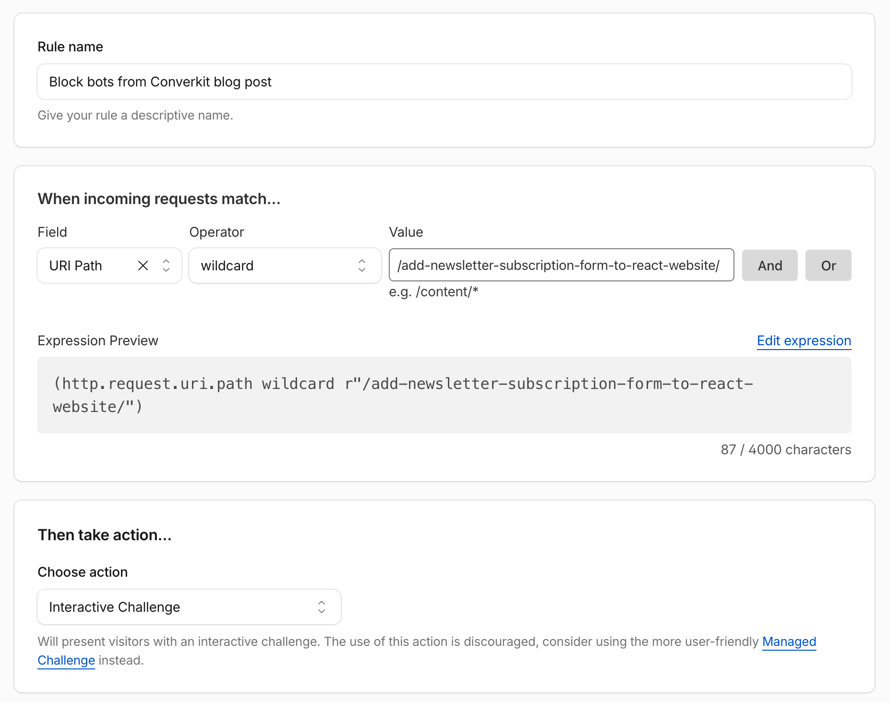
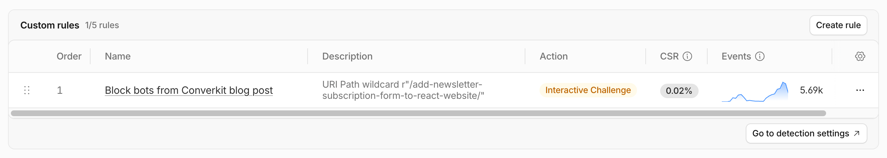
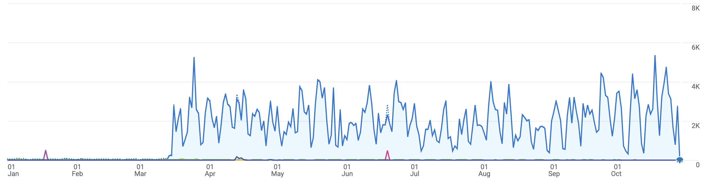
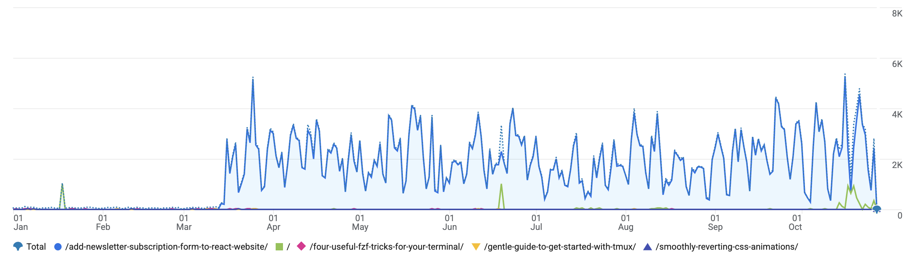

<div class="photo-caption">
Photo by <a href="https://unsplash.com/@zoshuacolah?utm_content=creditCopyText&utm_medium=referral&utm_source=unsplash">Zoshua Colah</a> on <a href="https://unsplash.com/photos/a-door-secured-with-a-bolt-and-padlock-2QjkAa5QaqY?utm_content=creditCopyText&utm_medium=referral&utm_source=unsplash">Unsplash</a>
</div>

Google Analytics is quiet until Saturday 14 March 2026. After that the site picks up a few thousand users a day and stays there. The form checks in [Stop Bots From Spamming Your ConvertKit Form](/stop-bots-from-spamming-your-convertkit-form) came a month later. On 13 April 2026 I shipped them in [pull request 150](https://github.com/nikolalsvk/blog/pull/150). A junk signup had to get past a honeypot, a timer, and [Turnstile](https://developers.cloudflare.com/turnstile/) before [ConvertKit](https://partners.convertkit.com/oqs53bno6l4l) heard about it. The requests kept coming.

They were reading [the blog post about adding a subscription form to a React website](/add-newsletter-subscription-form-to-react-website). That post shows the public ConvertKit URL, so it is an easy page to flag and later hammer. Cloudflare looked at those requests and scored them as people, which indicated those are some high-profile bots. Bot Fight Mode, and the rest of the automatic bot tooling, only acts on traffic Cloudflare has already decided is a bot. A high score means those switches sit there.

The [bot score](https://developers.cloudflare.com/bots/concepts/bot-score/) runs from 1 to 99. A 1 is almost certainly automated. A 99 is almost certainly a person, so a high score is what left Bot Fight Mode idle. Two days after Turnstile, on 15 April 2026, [pull request 151](https://github.com/nikolalsvk/blog/pull/151) stopped rendering the subscribe form on that one post. The page was still up, and the requests kept coming.

The form came off because signups were still landing, not because the page views had. There were fewer of them. They still cleared Turnstile, ConvertKit still got the subscribe, and some of the addresses confirmed the email. [Managed mode](https://developers.cloudflare.com/turnstile/concepts/widget/) only puts a checkbox up when Cloudflare is unsure, and Cloudflare was not unsure about these clients. The same score that left Bot Fight Mode idle handed them a token. Double opt-in did not catch the ones that could open the inbox.

I stopped waiting for the score. On 26 October 2026 I turned on a custom rule. On that one path, every visitor gets an [interactive challenge](https://developers.cloudflare.com/cloudflare-challenges/challenge-types/challenge-pages/).

## What a custom rule is

A [custom rule](https://developers.cloudflare.com/waf/custom-rules/) is a condition you write, plus an action Cloudflare takes when the condition matches. The request has to pass through Cloudflare first. If the DNS record for the site is DNS-only, Cloudflare never sees the visit and the rule never runs.

The rule I saved is named `Block bots from Converkit blog post`. The expression is:

```txt
(http.request.uri.path wildcard r"/add-newsletter-subscription-form-to-react-website/")
```

That is URI Path, operator wildcard, value `/add-newsletter-subscription-form-to-react-website/`. The action is **Interactive Challenge**.



<div class="photo-caption">
The saved rule. One path, action set to Interactive Challenge.
</div>

Cloudflare's own form asks you to prefer a [Managed Challenge](https://developers.cloudflare.com/cloudflare-challenges/challenge-types/challenge-pages/#managed-challenge-recommended). A managed challenge lets Cloudflare pick. Cloudflare had already picked "person" for these clients, which is why the automatic tools never fired. An interactive challenge puts a page in front of the URL anyway. A person solves it. A script that only knows how to `GET` the HTML and `POST` the form goes no further.

A JavaScript challenge is the quieter version. It runs in the background and hopes the client executes it. I wanted the visit to stop, so I took the challenge a person can see.

After a person passes, Cloudflare sets a `cf_clearance` cookie. Later requests from that browser skip the challenge until the cookie expires.

## Where to click

In the Cloudflare dashboard, open the site, then **Security**, then **WAF**, then **Custom rules**. The menu has moved before. If WAF is gone, look for **Security rules**. The page you want has a **Create rule** button.

Create a rule.

- **Rule name:** something you will recognize in the event log. Mine is `Block bots from Converkit blog post`.
- **Field:** URI Path.
- **Operator:** wildcard.
- **Value:** the path, `/add-newsletter-subscription-form-to-react-website/`.
- **Action:** Interactive Challenge.

The expression preview should match the block above. Save it, and put it above any rule that skips WAF checks. A skip that matches first wins, and your challenge never runs.

Open the post in a private window. You should see the challenge once, then the article. A `curl` of the same URL should get the challenge page, not the post.

## The drop

The rule list is the first place the matches show up. The day after I saved it, this one had already fired 5.69k times. That is 0.02% of traffic on the zone, and it is all on one old tutorial.



<div class="photo-caption">
5.69k matches the day after the rule went on. 0.02% of traffic on the zone.
</div>

Analytics is the longer picture. From January through 13 March the line sits on the floor. On 14 March it jumps, and from there it runs between roughly one and six thousand users a day, through the April form changes and on to October. The challenge is the last day of this chart, 26 October, so the drop is a point at the end, not a new flat line yet.



<div class="photo-caption">
Users per day for 2026. Quiet until 14 March, then a few thousand a day.
</div>

Pages and screens makes the same line specific. The total and `/add-newsletter-subscription-form-to-react-website/` sit on top of each other from 14 March on. The home page and the other posts barely leave the floor.



<div class="photo-caption">
The newsletter tutorial and the site total sit on the same line from 14 March.
</div>

## What this leaves alone

The rest of the blog is unchanged. The rule matches one path. Home, tags, and every other post stay as they were.

The form on that post has been gone since 15 April 2026. The template skips `SubscribeForm` when the slug is `/add-newsletter-subscription-form-to-react-website/`. A person who passes the challenge can still read the tutorial. They do not get a form to submit.

A script that already saved `https://api.convertkit.com/v3/forms/<form_id>/subscribe` never touches this path. Cloudflare cannot see that request. The function, Turnstile, and double opt-in from the [previous post](/stop-bots-from-spamming-your-convertkit-form) are what meet it. If that URL is the whole problem, rotate the form id. The challenge is for the page.

## Summing up

I wanted the bots classified, and then blocked, by the product that is supposed to know a bot from a browser. They arrived looking like browsers. The fix was a custom rule that refuses to care about the score, and asks every client on that path to solve a challenge.

Until the next one, cheers.
